# SparkV Feature Guide

SparkV turns the MacBook notch into a control center. Hover the notch and a black drawer slides out with media controls, a file tray, your day, converters, knowledge Spaces and a hub of more than 20 agents. When the drawer is closed, live activities (volume, battery, AirPods, notifications, meetings, recordings) show beside and under the camera.

This guide lists every feature with a screenshot, where to find it, how to use it, who it is for, the permissions it needs, and how it was checked.

**How the screenshots were made.** Every picture in `screenshots/` is a real SparkV view, rendered offscreen from the current source code with sample data (no mock-ups), dark appearance, at real size (2x). The renders ran in a throwaway home folder, so none of your own data appears. Live system values (CPU, memory, network, volume) in the Widgets picture are this Mac's real readings at the time of the render.

**Status labels**

- **Verified headless**: compiled in the full app build, the UI entry point is wired in code (tab, tile, menu item or hotkey), the view renders with data, and the feature's test harness passes where one exists.
- **Needs a live check**: everything above holds, but the part that matters (a hardware key, the camera, the microphone, a system permission, another app) can only be confirmed by using the running app. The reason is given each time.

---

## Contents

1. [Quick start](#quick-start)
2. [Shortcuts cheat sheet](#shortcuts-cheat-sheet)
3. [The drawer and header tabs](#1-the-drawer-and-header-tabs)
4. Header tabs: [Home](#2-home-media-shortcut-capsules-and-camera-mirror) · [Widgets](#3-widgets) · [Tray](#4-tray-tray-ai-and-airdrop) · [Today](#5-today-calendar-join-and-timer) · [Converter](#6-converter) · [Spaces](#7-spaces) · [Agents hub](#8-agents-hub) · [Flow](#9-dictation-and-flow) · [Clicky](#10-clicky-ask-about-your-screen) · [Gear menu](#11-gear-menu-settings)
5. Agents: [Universal Search](#12-universal-search) · [Focus](#13-focus-and-screen-effects) · [Modes](#14-modes) · [Quick Capture](#15-quick-capture-and-screenshot-to-clipboard) · [Copy Text](#16-copy-text) · [Reply Drafter](#17-reply-drafter) · [Ask Screen](#18-ask-screen) · [Prompt Refiner](#19-prompt-refiner) · [Clipboard](#20-clipboard-history-c-button-and-paste-stack) · [Screen recording](#21-screen-recording) · [File Drop](#22-file-drop) · [Downloads](#23-downloads) · [Live Translation](#24-live-translation) · [UI Audit (developer testing)](#25-ui-audit-developer-testing-of-websites) · [Job Agent](#26-job-agent) · [Browser Flows](#27-browser-flows) · [Screen Distance](#28-screen-distance) · [Flow Canvas](#29-flow-canvas) · [Setup](#30-onboarding-and-permissions)
6. [Meeting notes and live answers](#31-meeting-notes-and-live-answers)
7. [Live activities](#32-live-activities)
8. [Face Unlock](#33-face-unlock)
9. [Verification summary](#verification-summary)
10. [Known limits and open problems](#known-limits-and-open-problems)

---

## Quick start

### 1. Install (build from source)

SparkV builds with the Xcode Command Line Tools; full Xcode is not needed.

```zsh
cd "/Users/koushikgoudshaganti/Desktop/Agency/Apple Face id/NotchIsland"
./build.sh                # release build -> build/SparkV.app
open build/SparkV.app
```

Requirements: an Apple silicon Mac on macOS 15 or later, ideally a MacBook with a notch (on other displays the island rests inside the menu bar). Node.js (`/opt/homebrew/bin/node`) is needed only for UI Audit and Browser Flows.

### 2. Signing and permissions

macOS ties privacy permissions (Accessibility, Screen Recording) to the app's signature. An ad-hoc signature changes on every build, so grants would be lost after each rebuild.

1. Create the stable local signing identity once: `./Scripts/create-signing-identity.sh` (it is already present on this Mac as "NotchIsland Developer").
2. Rebuild with `./build.sh`. The log must end with `Signed with: NotchIsland Developer`. If macOS asks whether codesign may use the key, choose **Always Allow**.
3. Quit any running SparkV, then open the new `build/SparkV.app`.
4. Grant the permissions once (see step 3 below). From then on rebuilding keeps every grant.

> Current state on this Mac (Oct 22): `build/SparkV.app` is signed with "NotchIsland Developer", so grants now survive rebuilds. The stray iCloud copies `SparkV 2.app` and `SparkV 3.app` were moved out of `build/`.

### 3. First launch and the Setup window

On first launch SparkV opens the Setup window: Welcome, Terms & Privacy, then Permissions. Nothing is requested until you click **Allow…** next to a permission, and every feature that lacks a permission keeps working in a reduced way.

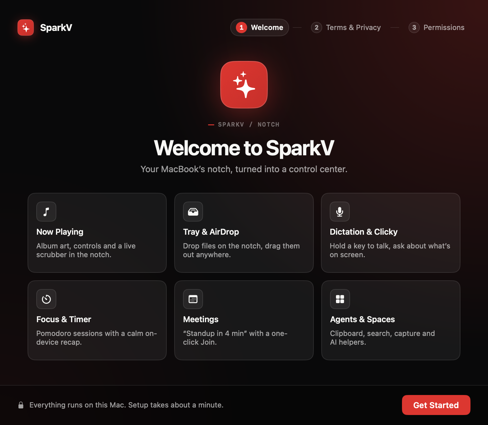
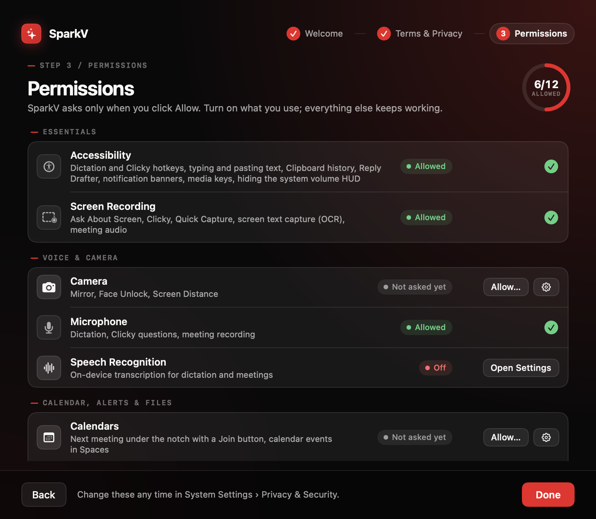

Open it again any time from **Agents hub › Setup** or **gear menu › Permissions & Setup**.

| Permission | Used by |
| --- | --- |
| Accessibility | Dictation and Clicky hotkeys, typing/pasting text, clipboard shortcuts, Reply Drafter, notification previews, media keys, replacing the system volume HUD |
| Screen Recording | Ask Screen, Clicky, Quick Capture, Copy Text, screen recording, meeting system audio |
| Camera | Mirror, Face Unlock, Screen Distance |
| Microphone + Speech Recognition | Dictation, Clicky questions, meeting recording |
| Calendars | Today meetings, Join button, meeting titles |
| Notifications | Timer and Focus chimes, Job Agent reminders |
| Bluetooth | AirPods battery |
| Downloads folder | Downloads watcher |
| Automation (Safari, Chrome, Mail) | Quick Capture of web pages, Spaces "Save Current Web Page / Selected Mail", Job Agent page capture |

### 4. Use it

Move the pointer onto the notch: the drawer opens. Move away: it closes after half a second. Drag a file onto the notch to drop it in the Tray.

---

## Shortcuts cheat sheet

| Shortcut | What it does | Feature |
| --- | --- | --- |
| Hover the notch | Open the drawer | Everywhere |
| Hold **fn** (or Right Option) | Talk, release to type the text where the cursor is | Dictation |
| Double-tap **fn** | Hands-free dictation (tap fn again to stop) | Dictation |
| **⌃⌘V** / **⌃⌘C** | Paste / copy the last dictation | Dictation |
| Hold **⌃⌥** | Ask Clicky about the screen out loud, release to send | Clicky |
| **⌥Space** | Universal Search panel | Search |
| **⌃⌥S** | Ask about a screen region (Space picks a window, Esc cancels) | Ask Screen |
| **⌃⌥T** | Copy the text in any screen region (OCR) | Copy Text |
| **⌃⌥C** | Quick Capture: selection, web page or screenshot into a Space | Quick Capture |
| **⌃⌥R** | Draft a reply in the focused message box | Reply Drafter |
| **⌃⌥⇧R** | Start / stop screen recording | Screen recording |
| **⌃⌥J** | Join the next calendar meeting | Today |
| **⌃⌥1** … **⌃⌥5** | Turn the first five Modes on or off | Modes |
| **⌘⇧V** | Clipboard stack at the text cursor (↑↓, ↩, ⌘1–9, type to search) | Clipboard |
| Hold **⌘**, tap **1–9**, tap **V** | Paste that item from history (1 = newest) | Clipboard |
| **fn + ⌃** on a job posting | Save the posting (again on the confirmation page marks it applied) | Job Agent |

Hotkeys that watch modifier keys (dictation, Clicky, ⌘+number+V, ⌘⇧V) need Accessibility. A hotkey already taken by another app is skipped and logged.

---

## 1. The drawer and header tabs

**Screenshot:** `screenshots/01-home.png` (full drawer with header)

**Where:** hover the notch. The header row sits beside the camera: places on the left, actions on the right.

| Icon (left) | Tab | Icon (right) | Action |
| --- | --- | --- | --- |
| House | Home | Moon | Focus (start/stop) |
| Four tiles | Widgets | Red record | Record meeting |
| Tray | Tray | 2x2 grid | Agents hub |
| Calendar | Today | Waveform | Flow (dictation) |
| Arrows | Converter | Cursor rays | Clicky |
| Stack | Spaces | Gear | Settings menu |

**How to use:** click an icon to switch the drawer page. The drawer remembers the last tab. Dragging a file over any tab flips to the Tray (Converter, Spaces and File Drop keep their own drop targets).

**Who it is for:** every SparkV user.

**Permissions:** none.

**Status:** Verified headless. All 21 drawer pages render inside the real `NotchNookLayoutView` with the header.

---

## 2. Home: media, shortcut capsules and camera mirror

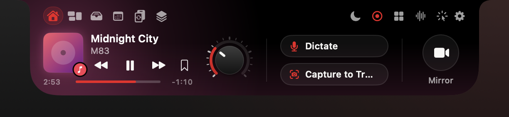

**Where:** header › House (Home).

**How to use**

- **Media:** album art with a colour glow, title and artist, previous / play-pause / next, a live scrubber (drag to seek, elapsed and remaining time) and a **bookmark** button that saves a moment in the track with a note. Works with any app that reports Now Playing (Music, Spotify, Safari, Chrome, podcasts).
- **Volume knob:** turn it with a drag or the scroll wheel.
- **Shortcut capsules (2):** default **Dictate** and **Capture to Tray**. Right-click a capsule (or gear › Button 1/2) to assign a built-in action or any shortcut from the Shortcuts app. `SHORTCUTS.md` has ten ready-made recipes.
- **Mirror:** click the camera circle to see yourself before a call; it turns off when you leave Home.

**Who it is for:** anyone who listens to music or joins video calls; power users who want one-click Shortcuts.

**Permissions:** Camera (mirror). Now Playing needs none on macOS 15.4+ (SparkV reads it through Apple's perl). Shortcuts that use scripts need "Allow Running Scripts" in Shortcuts.

**Status:** Needs a live check: the render proves the layout, scrubber, bookmark button and glow; real Now Playing data, the camera and running a Shortcut need the running app.

---

## 3. Widgets

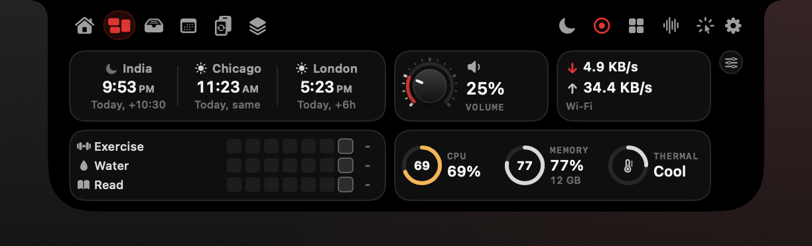
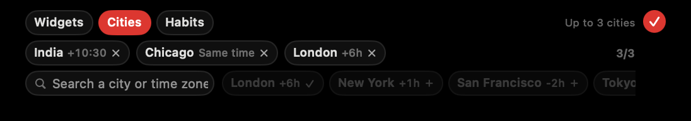

**Where:** header › Widgets (second icon), or Agents hub › Widgets.

**How to use**

- **World clocks:** India, Chicago and London by default, each with day/night, "Today/Tomorrow" and the offset from your time. **To change them:** right-click the clocks › **Choose Cities…**, or click the sliders button at the right edge of the widgets page › **Cities**. Remove a city with ×, type in **Search a city or time zone** (for example "Tokyo" or "New York") and click it to add, reorder with the arrows. Up to 3 cities; the choice is saved.
- **Volume knob:** system output volume with a live level ring.
- **Habits:** tick today's square for Exercise, Water, Read (edit the list under **Habits**, up to 6).
- **CPU / Memory / Thermal** gauges and **Network** down/up speed. They sample only while visible.
- **Widgets** section of the editor: choose which widgets show and their order.

**Who it is for:** remote teams across time zones, anyone who wants system stats at a glance.

**Permissions:** none.

**Status:** Verified headless. Rendered with the real defaults (India +10:30, Chicago, London +6h from Chicago time) and the city editor; widget tests re-run (see summary).

---

## 4. Tray, Tray AI and AirDrop

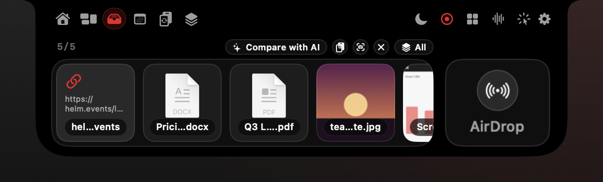

**Where:** header › Tray, or drag any file, image, link or text onto the notch.

**How to use**

1. Drop files on the notch (or click **Paste** / **Capture** in the tray toolbar). Screenshots are copied in; other files stay where they are.
2. Drag an item out into any app. Shift-drop keeps the drawer open. Cmd-click selects several.
3. **AirDrop:** drop files on the AirDrop tile at the right.
4. **Tray AI** (sparkles button, "Ask AI" / "Compare with AI"): What is this?, Explain, Summarize, Copy Text (OCR), Improve writing, Check spelling, List items, Translate, Web search, Receipt to JSON, Compare designs, Add to Calendar, or a custom question. Runs on device (Apple Intelligence); Groq is used only if you allow it.

**Who it is for:** designers, writers, anyone moving files between apps; people who screenshot a lot.

**Permissions:** Screen Recording (Capture), none for drag and drop.

**Status:** Needs a live check: the shelf renders with a PNG, JPG, PDF, DOCX and a link; drag in/out and AirDrop need a real drag session.

---

## 5. Today: calendar peek, Join and timer

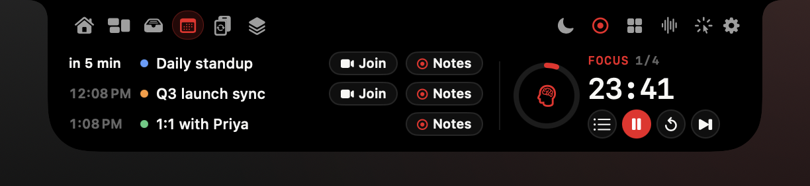

**Where:** header › Today. A meeting also appears under the notch 10 minutes before it starts ("in 4 min" with **Join**).

**How to use**

- Meetings for the next hours with **Join** (Zoom, Meet, Teams, Webex links are detected) and **Notes** (starts recording that meeting with notes).
- **⌃⌥J** joins the next meeting from anywhere.
- **Timer:** Pomodoro (focus/break rounds, shown "FOCUS 1/4") or a plain countdown; pause, reset, skip, list of presets.

**Who it is for:** people with back-to-back meetings.

**Permissions:** Calendars (click **Connect Calendar** the first time), Notifications for the chime.

**Status:** Needs a live check: the render shows three sample meetings with Join buttons and a running Pomodoro; reading your calendar needs Calendars access in the running app.

---

## 6. Converter

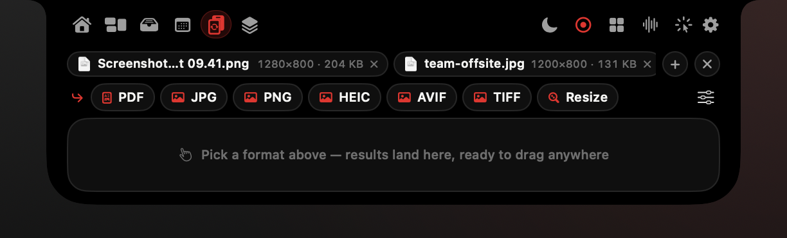

**Where:** header › Converter (arrows icon). Drop a file on the page.

**How to use:** drop a PDF, image, document, spreadsheet or slides, then click a format: Word, JPG, PNG, TXT, Compress, Split, Extract, Remove pages, Rotate, page Numbers, Watermark, Protect, Unlock, Repair, OCR, Merge (several PDFs), Images to PDF, Resize. Results appear in the box underneath, ready to drag anywhere or add to the Tray. The sliders button holds options (quality, page ranges, password).

**Who it is for:** students, office workers, anyone who uses iLovePDF-style tools; works offline.

**Permissions:** none.

**Status:** Verified headless. Rendered with a 3-page PDF and the full format row; converter harness passed in the earlier validation round.

---

## 7. Spaces

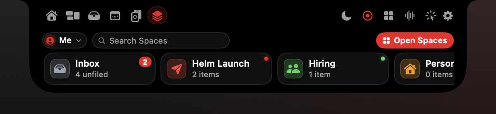
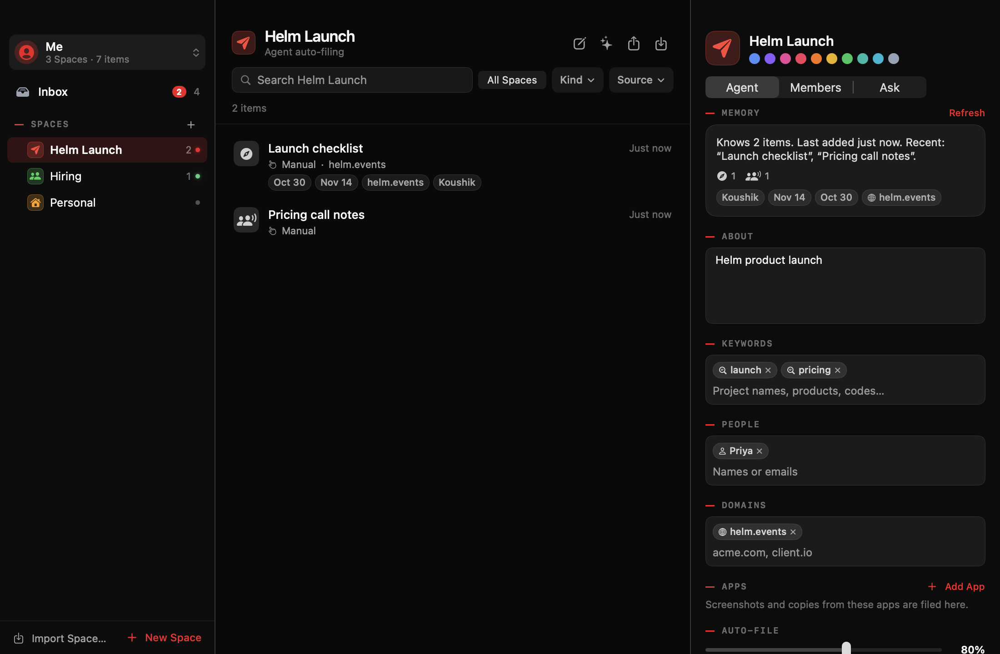

**Where:** header › Spaces (stack icon); **Open Spaces** for the full window; gear › Spaces.

**How to use**

1. Create a Space per client, project or team (**New Space**), with keywords, people, domains and apps.
2. SparkV files meetings, notes, dictations, screenshots, web pages, mail and clipboard items into the right Space automatically (above the auto-file threshold) or leaves them in the **Inbox** with a suggestion.
3. Each Space keeps a **Memory** summary; **Ask** answers questions from the Space's items with citations.
4. Personas ("Me") keep separate sets of Spaces; Spaces can be exported and shared.

**Who it is for:** agencies and consultants with several clients, founders, researchers.

**Permissions:** Automation (Safari/Chrome/Mail) only for "Save Current Web Page" and "Save Selected Mail".

**Status:** Verified headless. Drawer and window rendered with three Spaces, filed items and extracted entities (dates, people, domains).

---

## 8. Agents hub

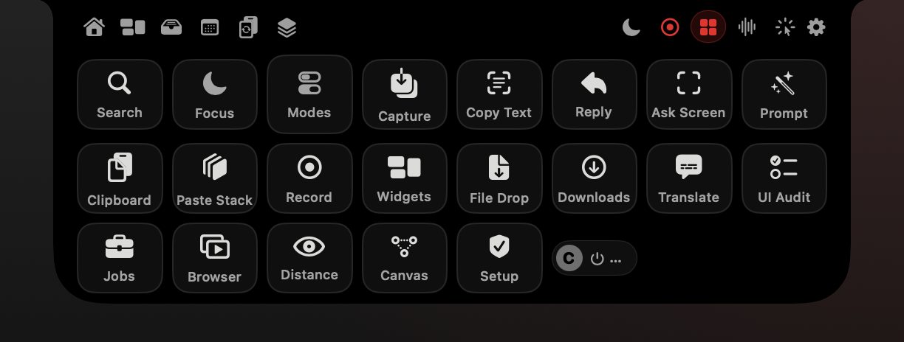

**Where:** header › 2x2 grid icon.

**Tiles (row by row)**

| Row | Tiles |
| --- | --- |
| 1 | Search · Focus · Modes · Capture · Copy Text · Reply · Ask Screen · Prompt |
| 2 | Clipboard · Paste Stack · Record · Widgets · File Drop · Downloads · Translate · UI Audit |
| 3 | Jobs · Browser · Distance · Canvas · Setup · **C** capsule |

A tile either opens its page in the drawer (Reply, Ask Screen, Prompt, Clipboard, Widgets, File Drop, Downloads, UI Audit, Jobs, Browser, Distance, Focus), runs at once (Search, Capture, Copy Text, Paste Stack, Record, Translate on/off, Canvas, Setup) or shows a menu (Modes). The **C** capsule pastes what is on the clipboard (⌥-click copies, hold or right-click for history). Hover a tile for its shortcut.

**Who it is for:** everyone; this is the launcher for every agent.

**Permissions:** per agent (below).

**Status:** Verified headless. All 22 cells render in the 8x3 grid and every tile's action is wired in `AgentsHubView`.

---

## 9. Dictation and Flow

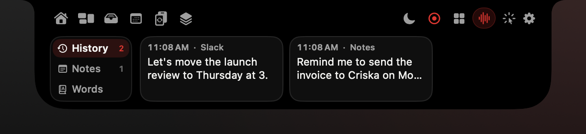


**Where:** hold **fn** anywhere; header › waveform (Flow) for history; gear › Dictation for settings.

**How to use**

1. Put the cursor in any text field, hold **fn**, speak, release. The text is cleaned up (punctuation, filler words removed, lists formatted) and typed in. Double-tap **fn** for hands-free.
2. **⌃⌘V** pastes, **⌃⌘C** copies the last dictation.
3. **Flow** tab: **History** (every dictation, with app and time), **Notes** (dictate a note), **Words** (custom dictionary: names and terms it should spell right) and snippets.
4. Gear › Dictation: choose the key (fn, Right Option, Off) and AI formatting.

**Who it is for:** writers, founders, anyone who types a lot; people with RSI.

**Permissions:** Microphone, Speech Recognition, Accessibility (typing and the fn key).

**Status:** Needs a live check: speech recognition and the fn key need the running app. Views render with sample history and the live band.

---

## 10. Clicky: ask about your screen

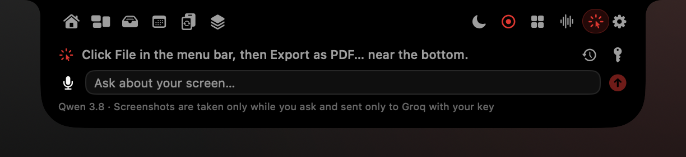


**Where:** hold **⌃⌥** and speak, or header › cursor icon and type a question.

**How to use:** ask "Where do I change the export format?" while looking at any app. Clicky captures the display under your mouse at that moment, answers out loud and in the band under the notch, and flies a pointer to the spot on screen. History icon shows earlier answers; the key icon adds an optional Groq API key for image-aware answers (without a key it reads the screen text on device).

It works in **any app and on any screen**, not only in a browser. It points and explains; it does not click or type for you.

**Who it is for:** people learning new software, support teams, older relatives.

**Permissions:** Accessibility (hold-to-ask), Screen Recording, Microphone, Speech Recognition.

**Status:** Needs a live check: screen capture and the ⌃⌥ hold need the running app.

---

## 11. Gear menu (settings)

**Where:** header › gear icon (right end). It is a system menu, so it cannot be rendered offscreen; its items, from the code:

- **Button 1 / Button 2:** assign the Home capsules.
- **Meetings:** Record / Stop, Meeting Notes…, meeting heads-up options, Suggest Answers to Questions, Allow Meeting Notes to Use My Groq Key, Live Translation (on/off, language, caption window).
- **Live Activities:** Now Playing beside the notch, Volume & Brightness, Hide macOS volume pop-up, Battery & AirPods (Enable AirPods Battery…), Timer, Meetings, Notifications, Hide Message Text.
- **Downloads:** Watch Downloads Folder, Show Progress Under the Notch, Suggest Folders with Apple Intelligence, Sorting Rules…
- **Dictation:** Hold to Talk key, AI Formatting, Paste/Copy Last Dictation.
- **Modes**, **Focus** (start, settings, Do Not Disturb, distraction reminders, recap, Screen Glow, shake, confetti, preview).
- **Clipboard:** Open Clipboard Stack ⌘⇧V, ⌘+Number+V, ⌘⇧V toggle.
- **Screen Tools:** Copy Text and Screen Recording options.
- **Agents:** UI Audit…, Job Agent…, Capture Job Page, Ask About Screen…, Pick a Window…, Prompt Refiner…, Browser Flows…, Draft Reply… with Reply Drafter options, Flow Canvas…, Send Tray to Flow Canvas, Allow Flow Canvas to Use My Groq Key.
- **Screen Distance**, **Spaces** (Open, Save Current Web Page, Save Selected Mail, Quick Capture), **Quick Capture**, **Search**, **File Drop** settings.
- **Permissions & Setup**, **Set Up Face Unlock… / Face Unlock Settings…**, **Launch at Login**, **Quit SparkV**.

**Status:** Verified headless (wiring read from `NotchNookLayoutView.swift`; not rendered).

---

## 12. Universal Search

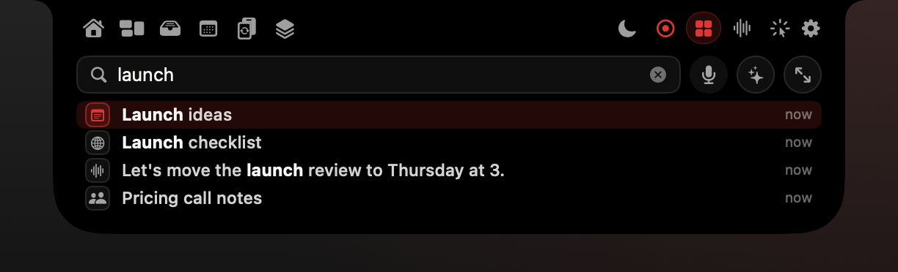
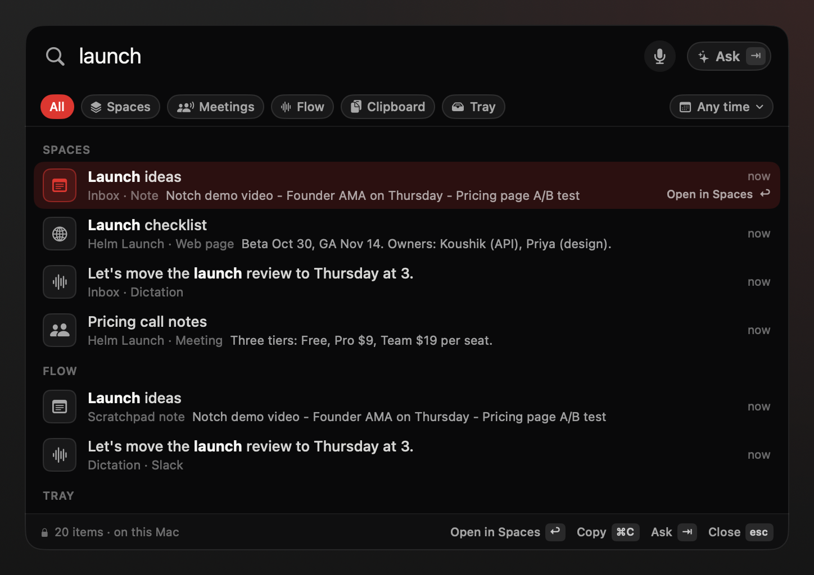

**Where:** **⌥Space** anywhere, or Agents hub › Search.

**How to use:** type a word. Results come from Spaces, meetings, Flow notes and dictations, clipboard history and the Tray, grouped by source, with filters (All, Spaces, Meetings, Flow, Clipboard, Tray, Any time). ↩ opens, ⌘↩ opens the link, ⌘C copies. Press **Tab (Ask)** to get an answer written from your own items with citations. The mic button searches by voice.

**Who it is for:** anyone who forgets where they saw something.

**Permissions:** none (Microphone for voice).

**Status:** Verified headless. The search engine ran live on the sample data: "launch" returned 21 items across Spaces, Flow and Tray.

---

## 13. Focus and screen effects

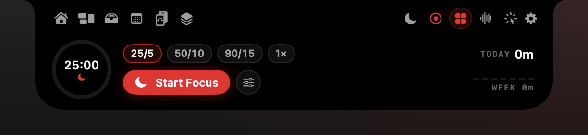
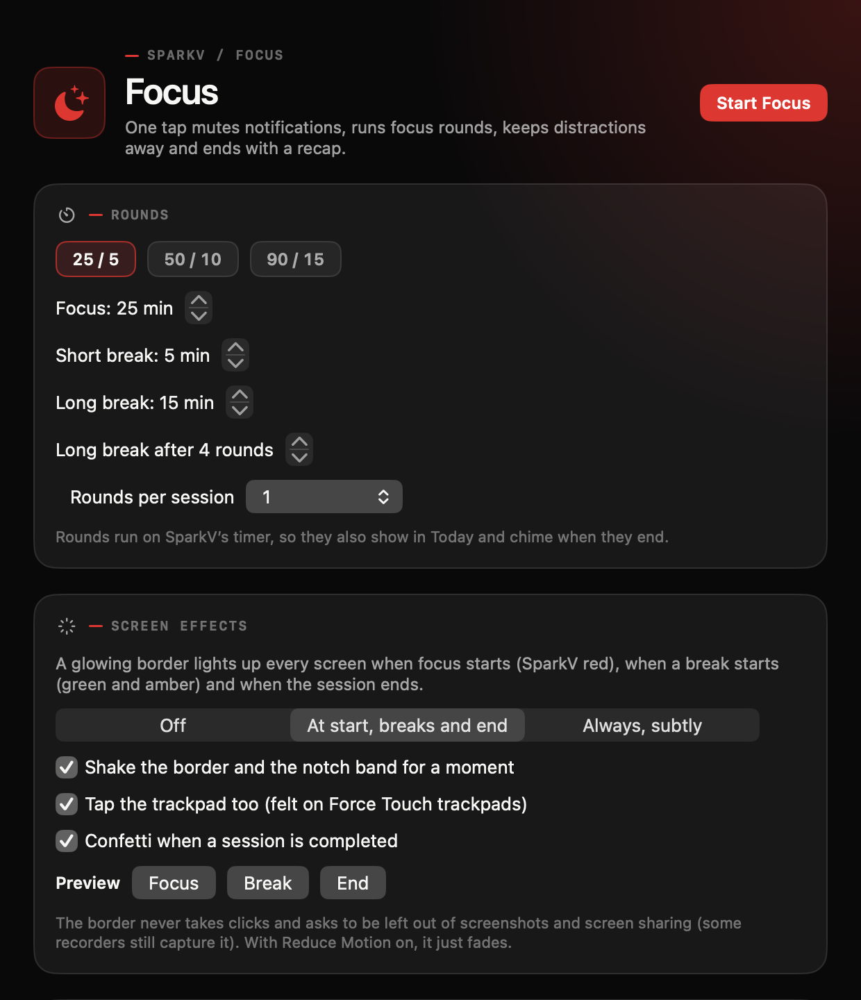

**Where:** header › moon icon (start/stop), Agents hub › Focus, gear › Focus.

**How to use:** pick a rhythm (25/5, 50/10, 90/15) and rounds, click **Start Focus**. SparkV turns on Do Not Disturb, runs the rounds on its timer, reminds you when you open a distracting app, and writes a recap at the end. **Screen Effects:** a glowing border around every screen at the start, at breaks and at the end (or always, subtly), with an optional shake, trackpad tap and confetti. Preview them with Focus / Break / End.

**Who it is for:** students, developers, writers.

**Permissions:** Notifications (chime). Do Not Disturb is switched through two Shortcuts named in Focus Settings › Do Not Disturb.

**Status:** Needs a live check: the glow is a screen-level overlay window and Do Not Disturb changes a system setting, so neither was triggered headlessly. Pages render.

---

## 14. Modes

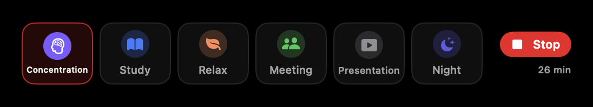
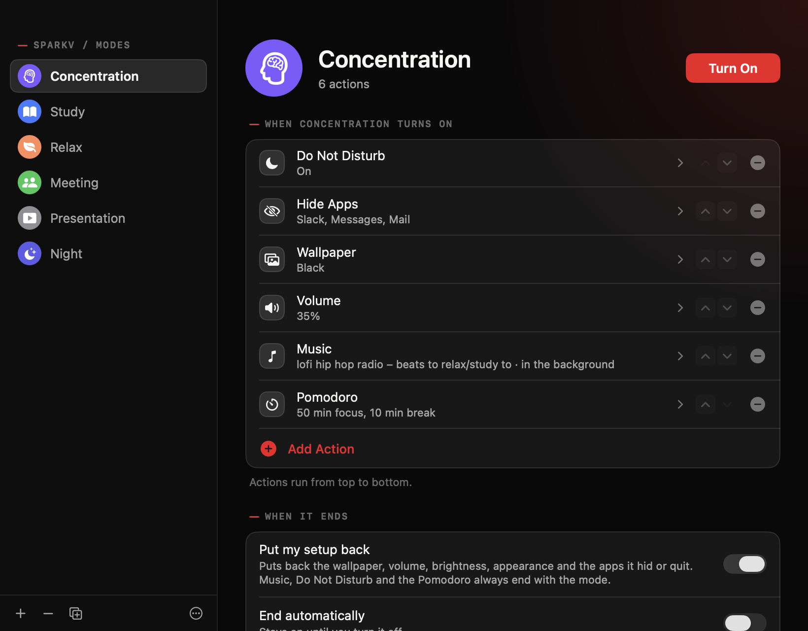

**Where:** Agents hub › Modes (menu), gear › Modes, **⌃⌥1–5**.

**How to use:** one click turns on a whole setup: Concentration, Study, Relax, Meeting, Presentation, Night. Each mode is a list of actions (Do Not Disturb, hide or quit apps, wallpaper, volume, brightness, appearance, music, Pomodoro). **Edit Modes…** opens the editor to add, reorder or remove actions. Turning a mode off puts your setup back (wallpaper, volume, apps).

**Who it is for:** people who switch between deep work, meetings and presenting.

**Permissions:** Accessibility/Automation for hiding apps; Shortcuts for Do Not Disturb.

**Status:** Needs a live check: modes change system settings (wallpaper, volume, DND), so they were not run headlessly. Mode engine tests passed in the earlier round; views render.

---

## 15. Quick Capture and screenshot-to-clipboard

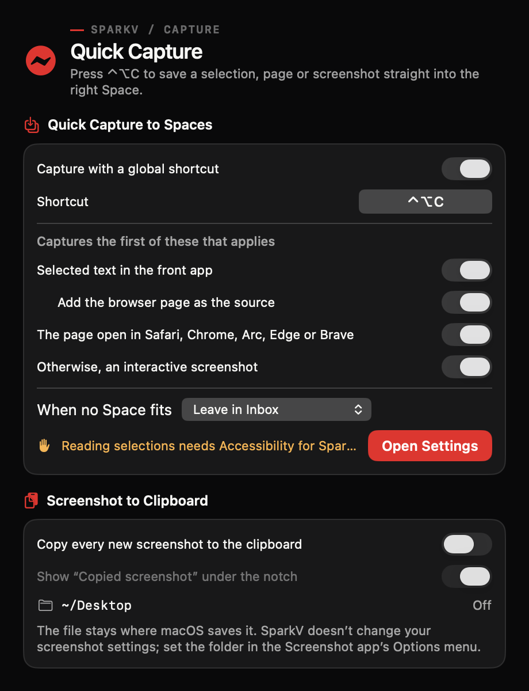


**Where:** **⌃⌥C**, Agents hub › Capture, gear › Quick Capture.

**How to use**

- **Quick Capture:** press ⌃⌥C. SparkV saves the first thing that applies: the selected text (with the browser page as source), else the open web page, else an interactive screenshot, straight into the best-matching Space. A small toast lets you change the Space or undo.
- **Screenshot to clipboard:** turn on "Copy every new screenshot to the clipboard". Every screenshot macOS saves (⇧⌘3/4/5) is also put on the clipboard as an image, with a "Copied screenshot" band. Your screenshot settings are not changed.

**Who it is for:** researchers, students, support teams.

**Permissions:** Accessibility (selected text), Automation (browser page), Screen Recording (screenshot), Desktop folder access (screenshot watcher).

**Status:** Needs a live check: capturing needs the running app and permissions.

---

## 16. Copy Text


**Where:** **⌃⌥T**, Agents hub › Copy Text, Ask Screen page › Copy text.

**How to use:** press ⌃⌥T, drag over any text on screen (an image, a video, a locked PDF, a slide in a call). The text is recognized on device and copied; the band shows how many lines.

**Who it is for:** everyone.

**Permissions:** Screen Recording.

**Status:** Verified headless for the recognition logic (screen-tools test suite re-run, see summary); the capture itself needs a live check.

---

## 17. Reply Drafter

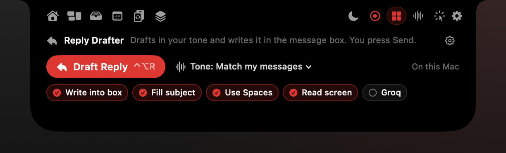

**Where:** **⌃⌥R** in Mail, Messages, Slack, WhatsApp, Gmail and other apps; Agents hub › Reply.

**How to use:** open a conversation and press ⌃⌥R. SparkV reads the thread, drafts a reply in your tone (learned from your messages) and writes it into the message box. You review and press Send. Chips: write into box, fill an empty subject, use Spaces as context, read the window when text is hidden, Groq. **Tone & Name…** sets your name and style.

**Who it is for:** sales, founders, support, recruiters.

**Permissions:** Accessibility (read and write the message box); Screen Recording only for the "read screen" fallback.

**Status:** Needs a live check (reads other apps). The page now uses the taller drawer, so it no longer overflows.

---

## 18. Ask Screen

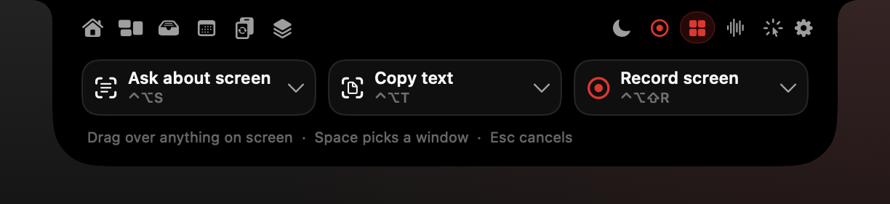

**Where:** **⌃⌥S**, Agents hub › Ask Screen, gear › Agents › Ask About Screen / Pick a Window.

**How to use:** press ⌃⌥S, drag over part of the screen (Space picks a window). A panel shows the capture with quick actions (explain, summarize, translate, copy text, detected links and dates) and a question box with streamed answers; **Save to Tray** keeps it.

**Who it is for:** anyone reading charts, errors, foreign text or dense pages.

**Permissions:** Screen Recording.

**Status:** Needs a live check: the results panel needs a real capture, so only the page renders.

---

## 19. Prompt Refiner

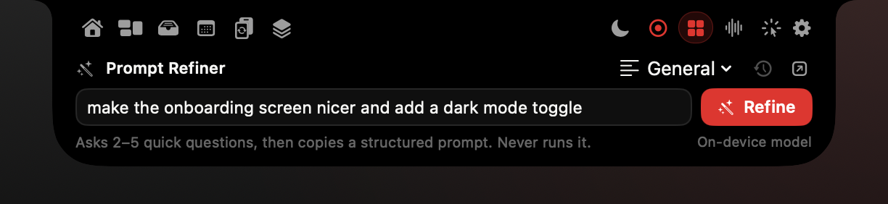
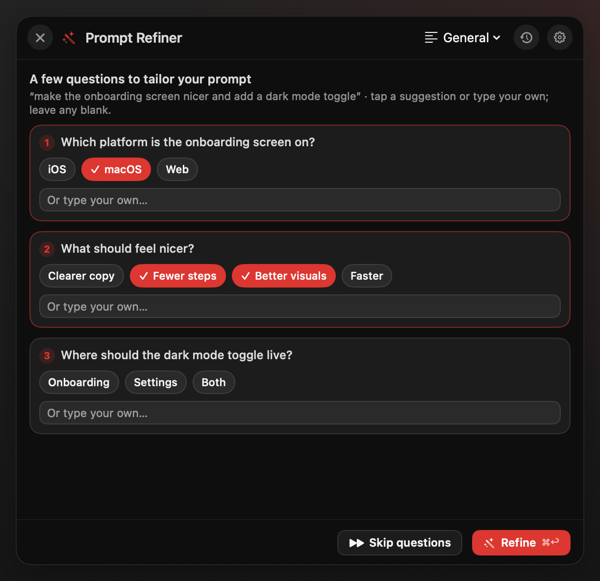

**Where:** Agents hub › Prompt, gear › Agents › Prompt Refiner….

**How to use:** type a rough request ("write a cold email for our notch app"), pick the target (ChatGPT, Claude Code, Gemini, an image model, or General), click **Refine**. Answer 2–5 quick questions with chips or your own words (or skip), then copy a structured prompt. It never runs the prompt itself. History keeps past prompts.

**Who it is for:** people who use AI tools daily and want better results.

**Permissions:** none (Microphone for dictating the request).

**Status:** Verified headless (on-device engine produced the questions shown; harness passed in the earlier round).

---

## 20. Clipboard history, C button and paste stack

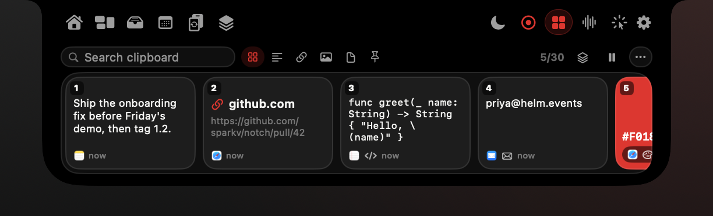
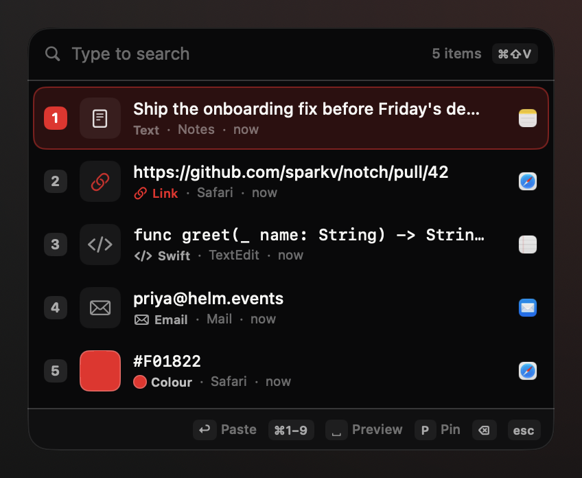

**Where:** Agents hub › Clipboard (page), Agents hub › Paste Stack or **⌘⇧V** (stack at the cursor), the **C** capsule, gear › Clipboard.

**How to use**

1. Clipboard history is **off until you turn it on** (privacy): Clipboard page › **Turn On**, or right-click the C capsule › Turn On Clipboard History.
2. Every copy is kept (text, links, code, colours, emails, images, files) with smart badges; passwords and private copies are skipped.
3. **⌘⇧V** opens the stack where you type: ↑↓ and ↩ paste, ⌘1–9 paste by number, space previews, P pins.
4. **Hold ⌘, tap a number, tap V** pastes that item directly (1 = newest).
5. **C** capsule: click pastes the current clipboard, ⌥-click copies, hold for history.

**Who it is for:** developers, writers, anyone who copies and pastes a lot.

**Permissions:** Accessibility (paste and the ⌘ shortcuts).

**Status:** Verified headless for history and stack logic (stack harness re-run, see summary); the global ⌘ shortcuts need a live check with Accessibility.

---

## 21. Screen recording


**Where:** **⌃⌥⇧R**, Agents hub › Record, gear › Screen Tools.

**How to use:** press ⌃⌥⇧R, drag an area, click a window, or press Return for the whole display. A red band shows the elapsed time; press ⌃⌥⇧R again (or the Stop tile) to save the movie to the Desktop, with a result card to drag it or add it to the Tray.

**Who it is for:** support, QA, product demos, tutorials.

**Permissions:** Screen Recording (Microphone if you record your voice).

**Status:** Verified headless for the recorder state machine (screen-tools suite with a fake engine); real capture needs a live check.

---

## 22. File Drop

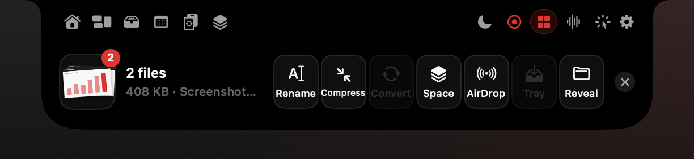

**Where:** start dragging files near the notch (a shelf appears only during the drag), or Agents hub › File Drop.

**How to use:** drop files, then pick an action: **Rename** (AI suggests a name from the content), **Compress** (zip or smaller images), **Convert** (opens the Converter), **Space**, **AirDrop**, **Tray**, **Reveal**. Drag the result anywhere.

**Who it is for:** anyone tidying downloads, sending files, sharing screenshots.

**Permissions:** none (Accessibility helps detect drags).

**Status:** Needs a live check: drag detection needs real drags; the strip renders with two files.

---

## 23. Downloads

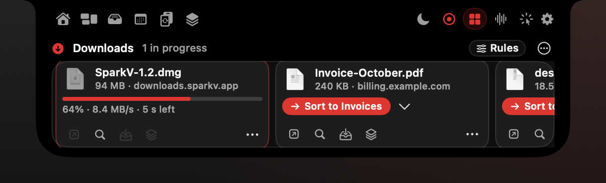
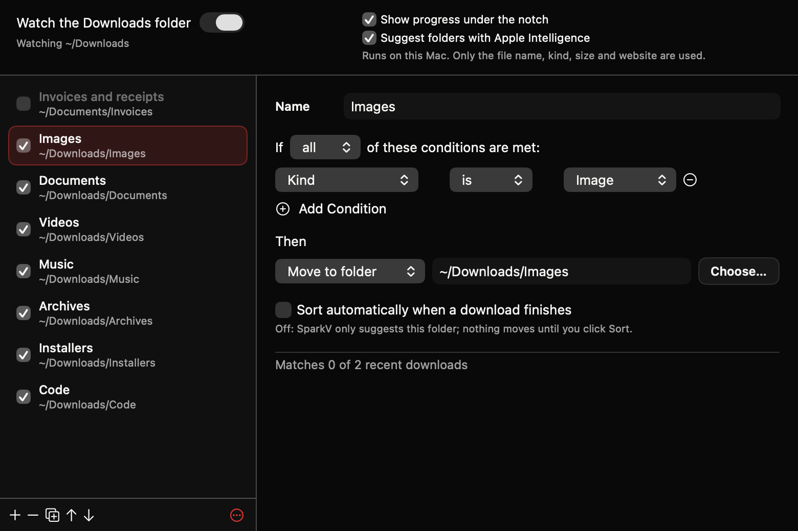

**Where:** Agents hub › Downloads, gear › Downloads.

**How to use:** turn on **Watch Downloads Folder**. Downloads from Safari, Chrome, Edge, Brave, Arc and Firefox show progress, speed and time left under the notch. Finished files get one-click **Sort** (by rules or an Apple Intelligence folder suggestion), open, Quick Look, Tray and Space buttons. **Rules** edits the sorting rules (Images, Documents, Videos, Music, Archives, Installers, Code, Invoices…).

**Who it is for:** everyone with a messy Downloads folder.

**Permissions:** Downloads folder access.

**Status:** Needs a live check (watches a real folder). Drawer and rules render.

---

## 24. Live Translation

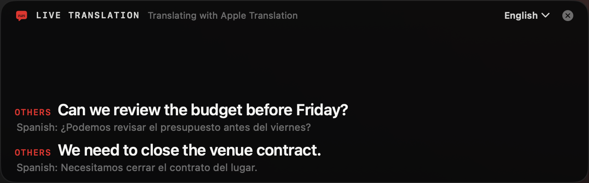

**Where:** Agents hub › Translate (turns it on), right-click the tile or gear › Meetings › Live Translation for the language and the caption window.

**How to use:** turn it on, choose the language you want to read (English by default), then record a meeting. Other people's speech is translated live into captions (with the original underneath); your own speech can be translated too. Apple Translation runs on device after a one-time language download.

**Who it is for:** international teams, interviews, travel.

**Permissions:** Microphone, Screen Recording (meeting audio), Speech Recognition.

**Status:** Needs a live check (needs a recorded meeting). Caption window renders.

---

## 25. UI Audit (developer testing of websites)

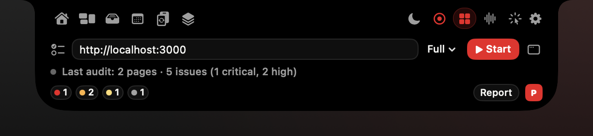
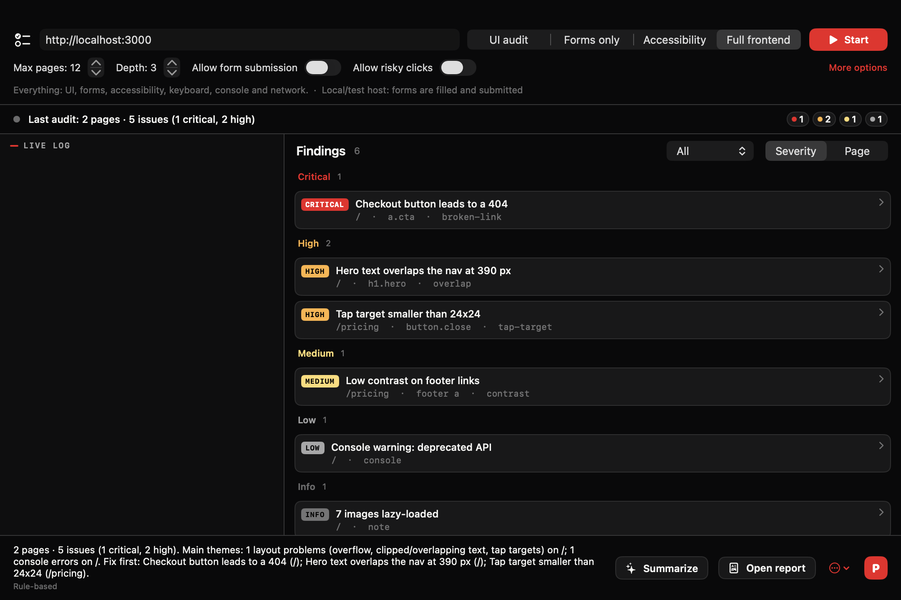

**Where:** Agents hub › UI Audit, gear › Agents › UI Audit….

**How to use**

1. Type your site's address (for example `http://localhost:3000` or a staging URL) and choose a mode: UI audit, Forms only, Accessibility, Full frontend.
2. Click **Start**. SparkV opens a Chromium window and walks your site like a tester: crawls pages (max pages, depth), scrolls, fills and submits forms (only on local/test hosts unless you allow it), clicks buttons (never risky ones like Delete or Log out unless allowed), checks layout at 1440 px and 390 px, runs axe-core accessibility checks, walks the Tab order, and records console errors and failed requests. You can **Take over** the browser and **Resume**.
3. Findings stream in by severity (Critical, High, Medium, Low) with the element, page, screenshot and steps to reproduce. **Summarize** writes a plain-English summary on device.
4. Click **P** to copy a ready-to-paste **fix prompt** for Claude Code, Cursor or Copilot: every issue with selectors, Playwright locators, steps and acceptance checks. **Open report** shows the HTML report.

**Who it is for:** frontend developers, QA testers, agencies shipping client sites, founders checking a site before launch.

**Permissions:** none for SparkV. Requires Node.js (Homebrew `node`) and Playwright's Chromium in `~/Library/Caches/ms-playwright` (`npx playwright-core install chromium` if missing).

**Status:** **Verified headless, end to end.** The screenshots come from a real run: SparkV's own `UIAuditController` audited the bundled planted-issue test site on 127.0.0.1 (6 pages, 69 findings: 3 critical, 15 high), the summary was written by Apple Intelligence on device, and the **P** button produced a 51,666-character fix prompt covering 60 issues. The runner's own self-test also passed 48/48 (all planted issues found, no POST sent to a non-test host, /logout and /account/delete never requested).

> Scope: UI Audit tests websites in its own Chromium. It does not test native Mac apps.

---

## 26. Job Agent

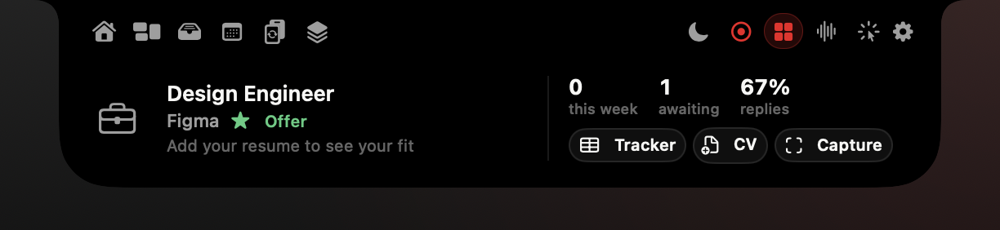
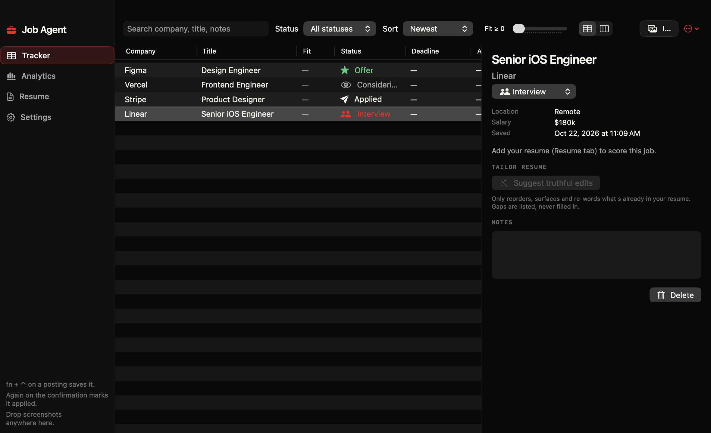

**Where:** Agents hub › Jobs, gear › Agents › Job Agent…, **fn + ⌃** on a posting.

**How to use:** add your resume (PDF, DOCX, RTF or text) under **Resume**. On any job posting (LinkedIn, Greenhouse, Lever, Workday…) hold **fn + ⌃**: SparkV saves it and scores your fit (hard skills, experience, keywords, education, title) with matching and missing skills. Press fn + ⌃ again on the confirmation page to mark it applied. The window has a Tracker (table or board), Analytics, deadlines and truthful tailoring suggestions. Screenshots of postings can be dropped in.

**Who it is for:** job seekers, career switchers, recruiters tracking candidates.

**Permissions:** Screen Recording or Automation (to read the posting), Notifications (deadline reminders).

**Status:** Verified headless for parsing and scoring (fit 81% computed live from the sample resume and posting); capturing from a browser needs a live check.

---

## 27. Browser Flows

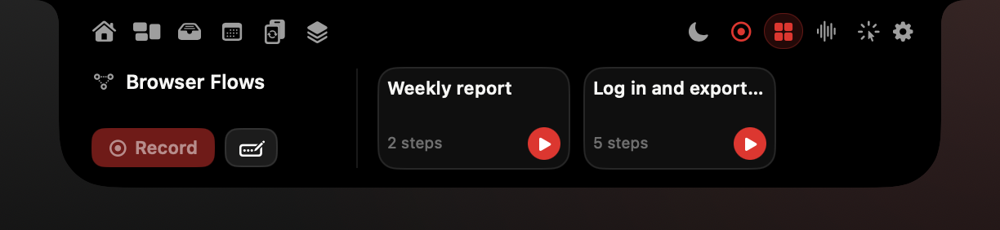
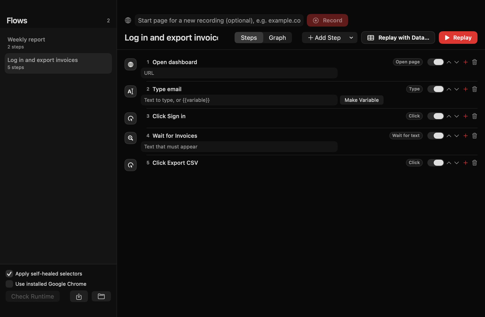

**Where:** Agents hub › Browser, gear › Agents › Browser Flows….

**How to use:** click **Record**, do a task once in the browser window (sign up, fill a form, download a report). SparkV records each step with several selector candidates; passwords become `{{password}}` and are asked at replay, never saved. Edit steps, turn values into variables, then **Replay** or **Replay with Data…** (one run per CSV row). If the site changes, self-healing selectors find the moved or renamed element.

**Who it is for:** operations, sales ops, QA, anyone repeating web chores.

**Permissions:** none for SparkV; Node.js and Playwright's Chromium (or "Use installed Google Chrome").

**Status:** Needs a live check. The recorder self-test was re-run twice: run 1 failed one replay ("v3", step 10 timed out at 4 s); run 2 passed that replay but the CSV-loop replay then hung past 400 s. The Mac was under heavy load (full disk, parallel builds), so this may be timing, but it is not a clean pass. Browser Flows drive their own Chromium only; they do not control other apps.

---

## 28. Screen Distance

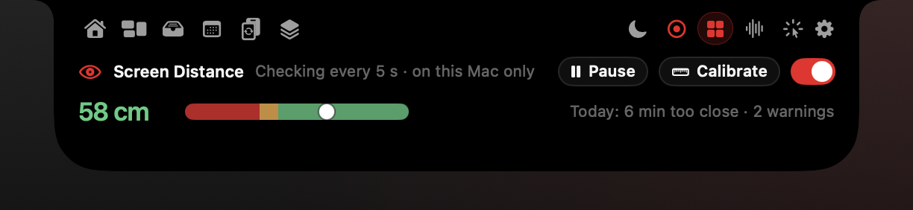

**Where:** Agents hub › Distance, gear › Screen Distance.

**How to use:** turn the switch on and click **Calibrate** once at a normal distance. If your face stays closer than 40 cm for a while, a full-screen notice asks you to move back; it continues when you do. Today's "too close" minutes and warnings are shown. Off by default.

**Who it is for:** children, students, anyone with eye strain.

**Permissions:** Camera.

**Status:** Needs a live check (camera). Distance math tests passed in the earlier round.

---

## 29. Flow Canvas

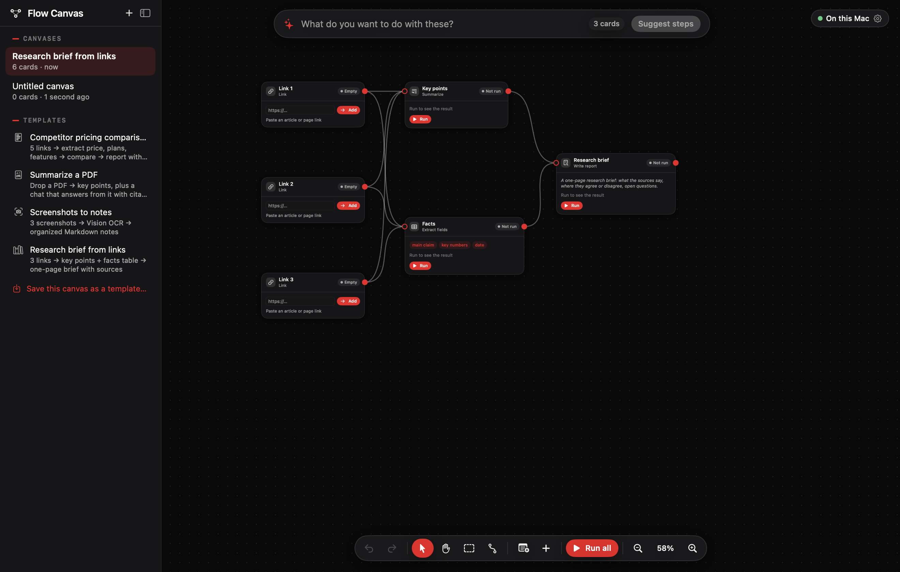

**Where:** Agents hub › Canvas, gear › Agents › Flow Canvas…, gear › Agents › Send Tray to Flow Canvas.

**How to use:** a whiteboard for AI workflows. Drop links, PDFs, screenshots and notes as cards, connect them to action cards (extract fields, compare, summarize, write report, chat with sources), click **Run all**. Or type what you want in "What do you want to do with these?" and **Suggest steps** builds the chain. Templates: Competitor pricing comparison, Summarize a PDF, Screenshots to notes, Research brief from links. Outputs export to Markdown/PDF/CSV, the Tray, Notes or a Space.

**Who it is for:** analysts, marketers, researchers, founders.

**Permissions:** none (Groq optional).

**Status:** Verified headless (template loads and lays out; window renders).

---

## 30. Onboarding and permissions

See [Quick start, step 3](#3-first-launch-and-the-setup-window). **Where:** first launch, Agents hub › Setup, gear › Permissions & Setup. The ring shows how many of the 12 permissions are allowed; each row has **Allow…** and a gear that opens the matching System Settings page.

**Status:** Verified headless (renders; statuses come from the system's own checks).

---

## 31. Meeting notes and live answers

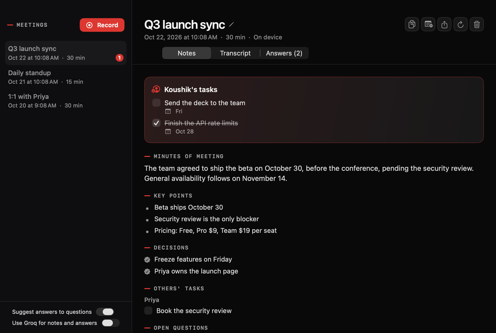
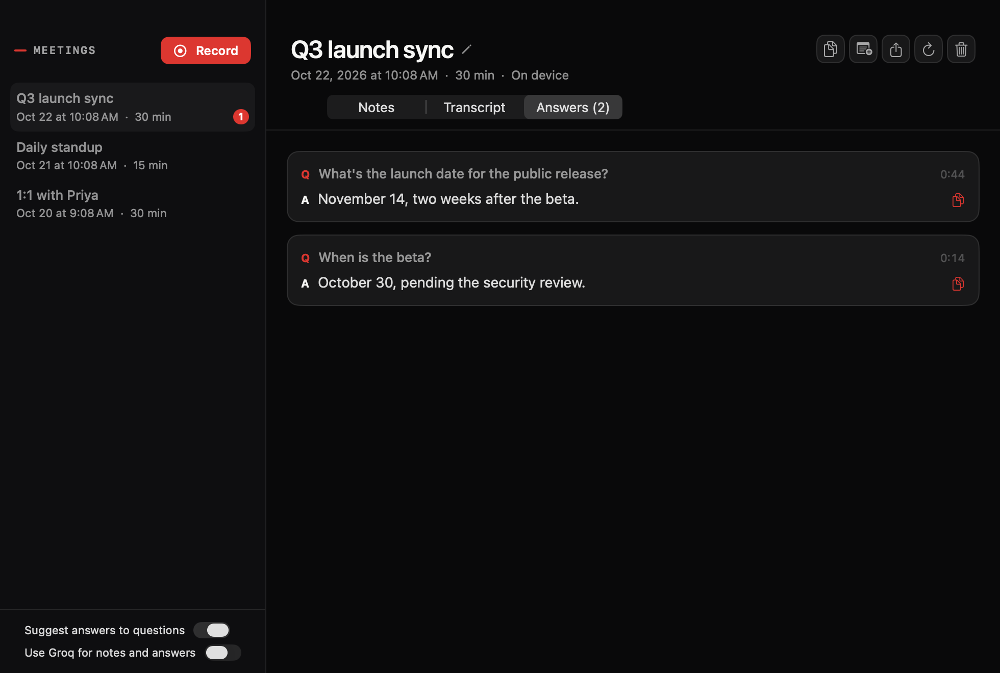

**Where:** header › red record button (one click), Today › Notes, gear › Meetings › Meeting Notes….

**How to use**

1. Click record. SparkV records your microphone and the meeting's audio (no bot joins the call) and transcribes on device. The notepad opens for your own notes.
2. **Live answers:** when someone asks you a question during the call ("Koushik, what's the status of the API migration?"), a suggested answer appears under the notch (turn on gear › Meetings › Suggest Answers to Questions).
3. Click stop. You get Minutes, Key points, Decisions, **your tasks** with due days, other people's tasks, the transcript and the answers, all searchable and filed into Spaces. Export or copy as Markdown.

**Who it is for:** managers, consultants, founders, recruiters.

**Permissions:** Microphone, Screen Recording (system audio), Speech Recognition; Calendars for titles.

**Status:** Needs a live check (audio capture). Notes and answers render from saved meetings.

---

## 32. Live activities

| Activity | Screenshot |
| --- | --- |
| Volume and brightness HUD (replaces the macOS pop-up) |  |
| Battery charging, low battery |  |
| AirPods connected with left/right/case battery |  |
| Notification preview (message text can be hidden) |  |
| Compact wings: now playing art and level meter beside the camera |  |
| Screen recording, Copy Text, screenshot copied, dictation, Clicky | see sections 21, 16, 15, 9, 10 |

**Where:** automatic while the drawer is closed; turn each on or off in gear › Live Activities.

**How it works:** each activity has a priority. Short alerts (volume, notifications) queue and show for their own time; longer ones (timer, meeting, recording) tuck into the compact wings after a 4-second peek. Hovering an activity opens the matching tab (a meeting opens Today with Join).

**Who it is for:** everyone.

**Permissions:** Accessibility (volume/brightness keys, notification banners), Bluetooth (AirPods).

**Status:** Needs a live check: key interception, banners and Bluetooth need the running app. The bands render; the activity queue was tested in the earlier round. In offscreen renders the compact wings sit higher than they should (see Known limits).

---

## 33. Face Unlock

**Screenshot:** none. The Face Unlock settings live inside the bundled GlanceKit module and read the login keychain, so they were not rendered offscreen.

**Where:** gear › Set Up Face Unlock… (later Face Unlock Settings…).

**How to use:** enroll your face, then unlock the Mac by looking at it; the notch shows the unlock animation. Liveness checks block photos.

**Who it is for:** anyone who wants Face ID-style unlock on a Mac.

**Permissions:** Camera, Accessibility; your login password is stored in the login keychain (this is why the stable signing identity matters).

**Status:** Needs a live check (camera and keychain).

---

## Verification summary

Checks run on Oct 22, 2026 against the current sources (snapshot taken 07:04).

| Check | Result |
| --- | --- |
| Full app (all `Sources/*.swift` plus the 22 `Sources/Labs/*` folders listed in `build.sh`) compiles with the Command Line Tools | Pass, no errors |
| Every drawer tab, hub tile, header icon and default hotkey is wired (read from `NotchNookLayoutView`, `AgentsHubView`, `NotchWindowController`) | Pass |
| Offscreen renders of 50 views with sample data | 50 written, all reviewed |
| UI Audit runner self-test (`Vendor/ui-audit/test/run-test.mjs`) | 48/48 pass |
| UI Audit end to end through SparkV's controller, plus the P fix prompt | Pass (6 pages, 69 findings, 51,666-char prompt) |
| Universal Search on sample data | Pass (21 results for "launch") |
| Browser Flows recorder self-test (`Vendor/browser-recorder/test/test.mjs`) | **Not clean**: run 1 failed one replay, run 2 hung in the CSV loop |
| Widgets harness (world clocks, time zones, knob, habits, gauges, network), rebuilt from current sources | 29,283 checks pass, 0 fail |
| Copy Text OCR + screen recorder harness, rebuilt against the current app sources | 63 pass, 0 fail |
| Clipboard history + paste stack harness (⌘⇧V, ⌘+number+V logic), rebuilt against the current app sources | 195 pass, 0 fail |

Harnesses from the earlier validation rounds (converter, Spaces, Prompt Refiner, Job Agent, meetings, dictation, Clicky, live activities, Focus, Modes, Downloads, File Drop, Reply Drafter, Universal Search, Live Translation, Quick Capture) were not all re-run this time; their features are marked from today's build, wiring and render checks.

---

## Known limits and open problems

1. **Signing:** the app is signed with the local "NotchIsland Developer" identity. That is enough for this Mac; selling needs an Apple Developer ID and notarization (see the business plan).
2. **Browser Flows self-test is not reliable** under load (see section 27).
3. **Drawer heights:** the Reply Drafter page now uses the tall drawer and the Agents hub has a few points of extra room; both overflowed slightly in the first renders.
4. **Compact wings position:** in offscreen renders the closed-island wing content (timer, now playing) draws near the top edge and is partly clipped. This may be an artefact of rendering without the real notch window; check it in the running app.
5. **"Control any app" is not a feature.** Clicky understands any app on any screen and points at things, Dictation and Reply Drafter type into any app, and Browser Flows / UI Audit drive their own Chromium. Nothing clicks or types through arbitrary apps on its own.
6. **Clipboard history is off by default** and must be turned on once.
7. **Not rendered offscreen:** the gear menu (system menu), Face Unlock settings, Ask Screen's results panel (needs a real capture), the Focus screen glow and the Screen Distance full-screen notice (screen-level overlays).
8. **AI:** on-device Apple Intelligence is used by default. Groq is optional per feature and needs your own API key; nothing uses it unless you turn it on.
9. **Hardware:** designed for the 14/16-inch MacBook Pro notch; on other screens the island sits in the menu bar.
